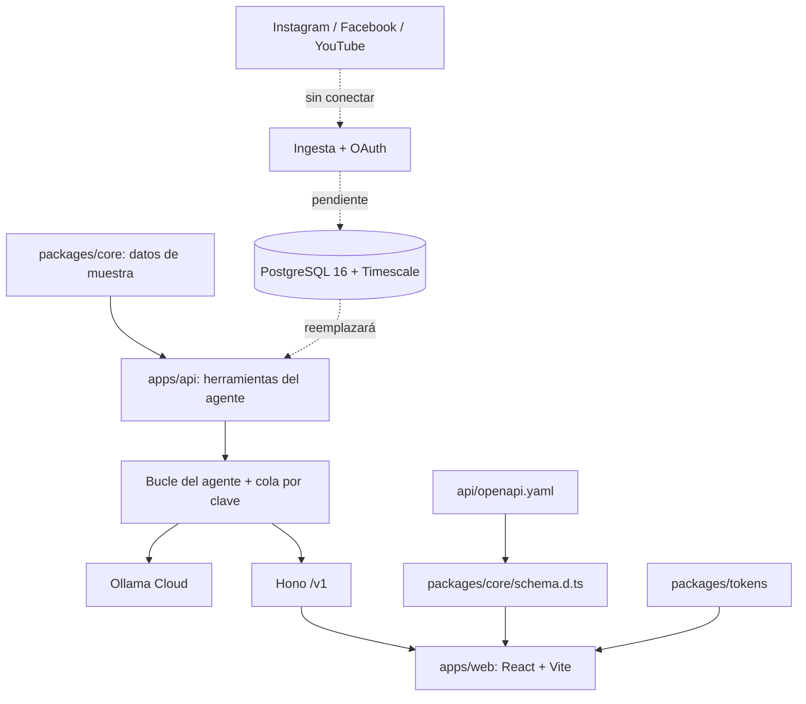

# Project Concept Map & Local Memory (J.A.R.V.I.S. Core)
> Última actualización: 2026-11-18 | Director: J.A.R.V.I.S. | Propietario: Sr. Miguel Ángel Ordóñez

## 1. Grafo conceptual

## 2. Design Tokens
Fuente única: `packages/tokens/tokens.json` (temas dark y light). Se genera con `node packages/tokens/build.mjs`.

## 3. Índice de módulos
| Módulo | Función | Agente | Estado |
| --- | --- | --- | --- |
| api/openapi.yaml | Contrato de la API (Redocly OK) | jarvis-code | Hecho |
| db/migrations 0001-0002 | Esquema núcleo y métricas | jarvis-code | Aplicado en PG16 |
| db/migrations 0003 | Timescale | jarvis-code | Sin probar |
| apps/api | Agente, claves cifradas, cola, streaming | jarvis-code | 12 pruebas OK, estado en memoria |
| apps/api/src/agent/tools.ts | 9 herramientas, incl. adjuntar_grafico | jarvis-code | Leen datos de muestra |
| apps/web | Inicio, Resumen, Contenido, Agente | jarvis-code | Compila; sin revisión en navegador este ciclo |
| packages/core | Muestra, analítica, tipos | jarvis-code | Estable |
| Conectores de redes | Ingesta real | jarvis-code | No existe |
| Login / multi-tenant | Usuarios y aislamiento | jarvis-code | No existe |
| CI / despliegue | Pruebas automáticas y hosting | jarvis-code | No existe |

## 4. Checkpoint ejecutivo
- Completado: carpetas completas en GitHub, contrato ajustado, gráficos adjuntos del agente.
- Rama: `claude/zealous-goodall-h4n83x`, sin fusionar a `main`, sin PR.
- Sin comprobar: conversación real con clave de Ollama Cloud.
- Siguiente decisión: alojamiento de PostgreSQL y primera red a conectar (ver informe de estado).
