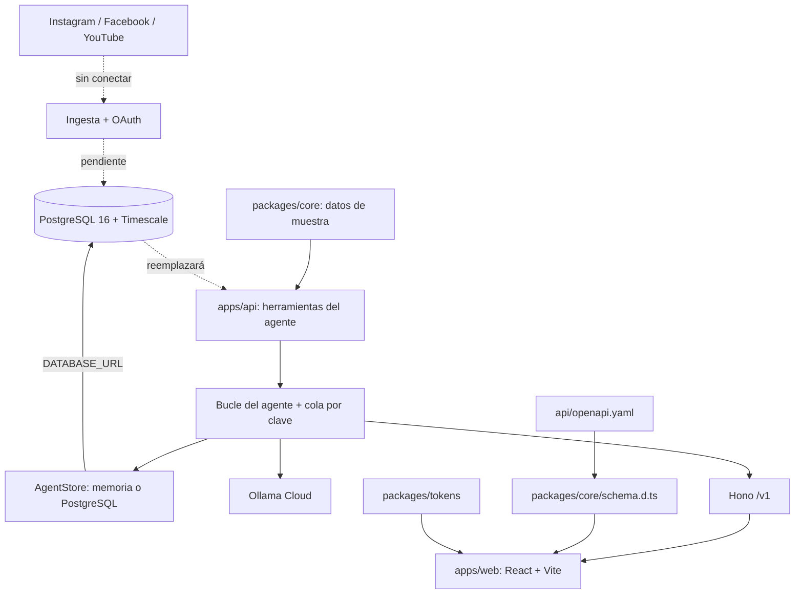

# Project Concept Map & Local Memory (J.A.R.V.I.S. Core)
> Última actualización: 2026-11-18 | Director: J.A.R.V.I.S. | Propietario: Sr. Miguel Ángel Ordóñez

## 1. Grafo conceptual

## 2. Design Tokens
Fuente única: `packages/tokens/tokens.json` (temas dark y light). Se genera con `node packages/tokens/build.mjs`.

## 3. Índice de módulos
| Módulo | Función | Agente | Estado |
| --- | --- | --- | --- |
| api/openapi.yaml | Contrato de la API (Redocly OK) | jarvis-code | Hecho |
| db/migrations 0001-0002 | Esquema núcleo y métricas | jarvis-code | Aplicado en PG16 |
| db/migrations 0003 | Timescale | jarvis-code | Sin probar |
| db/migrations 0004 + db/seed | Persistencia del agente (clave opcional, adjuntos) y marca de muestra | jarvis-code | Aplicado en PG16 |
| apps/api | Agente, claves cifradas, cola, streaming | jarvis-code | 14 pruebas OK (2 con PostgreSQL) |
| apps/api/src/store | AgentStore: memoria por defecto, PostgreSQL con DATABASE_URL | jarvis-code | Probado en PG16 local |
| apps/api/src/agent/tools.ts | 9 herramientas, incl. adjuntar_grafico | jarvis-code | Leen datos de muestra |
| apps/web | Inicio, Resumen, Contenido, Agente | jarvis-code | Compila; sin revisión en navegador este ciclo |
| packages/core | Muestra, analítica, tipos | jarvis-code | Estable |
| Conectores de redes | Ingesta real | jarvis-code | No existe |
| Login / multi-tenant | Usuarios y aislamiento | jarvis-code | No existe |
| .mcp.json | MCP Meta Social Technologies (apps, App Review, webhooks) | jarvis-code | Registrado; OAuth pendiente en local |
| CI / despliegue | Pruebas automáticas y hosting | jarvis-code | No existe |

## 4. Integración Instagram (investigación 2026-11-18)
Detalle y fuentes: `docs/instagram-integracion.md`.
- Vía elegida (propuesta): **Facebook Login for Business**: única con Business Discovery (competidores) y webhook `story_insights`. Requiere IG profesional vinculada a Página.
- "En vivo" = sondeo: cuenta cada 1-3 h, media reciente cada hora, historias cada hora (caducan a las 24 h), competidores cada 6-12 h. Retraso de Meta hasta 48 h; Meta guarda 90 días de cuenta.
- `impressions` retirada (abril 2025): usar `views`. API v27.0.
- Competidores (máx. 5): seguidores, nº publicaciones, likes/comentarios/vistas por pieza. Sin alcance, demografía ni historias.
- Login web: OAuth con callback HTTPS del servidor. CLI: navegador + polling a `/auth/cli/poll`, recibe token de Atalaya; el de Meta no sale del servidor.
- Cuentas de MOGA con testers: acceso estándar, sin App Review. Clientes externos: App Review + verificación de negocio.

## 5. Checkpoint ejecutivo
- Completado: carpetas completas en GitHub, contrato ajustado, gráficos adjuntos del agente, persistencia del agente en PostgreSQL (opcional por DATABASE_URL).
- Rama: `claude/zealous-goodall-h4n83x`, sin fusionar a `main`, sin PR.
- Sin comprobar: conversación real con clave de Ollama Cloud.
- Pendiente: claves de Ollama aún en disco, no en `ollama_keys`; eventos del streaming no se guardan.
- Pendiente del Señor: crear app Business en Meta (Facebook Login for Business + Instagram), confirmar IG de MOGA profesional y vinculada a Página, 5 usuarios de competencia, túnel HTTPS (ngrok o Cloudflare), prueba con clave de Ollama.
- Siguiente decisión: aprobar la vía Facebook Login para construir el conector (tablas, OAuth web y CLI, ingesta).
